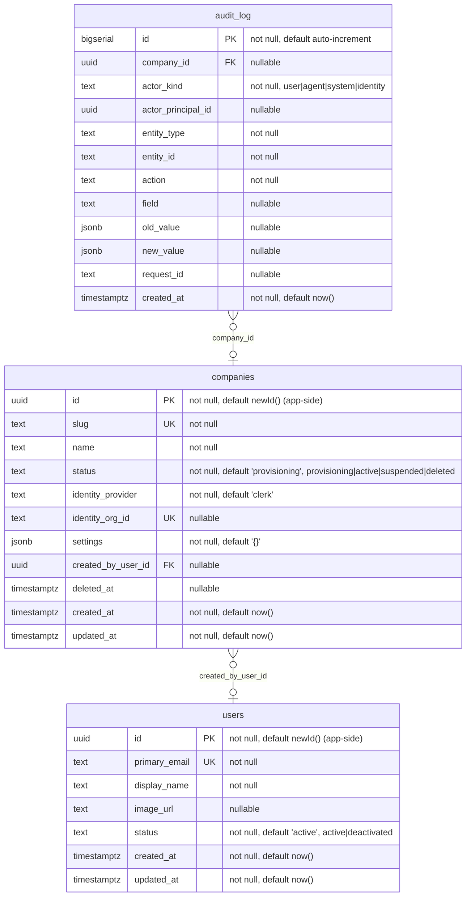

# Database schema

> Generated from `packages/db/src/schema/` by `pnpm --filter @mwc/db diagram`. Do not edit by
> hand: `pnpm mwc check` fails when this file and the schema disagree.

Tables: 3. Migrations: 1, the last is `0000_init`.

Legend: `PK` primary key, `FK` foreign key, `UK` unique on its own; each attribute says whether it
may be null, its default and, for an enum-like CHECK, the allowed values. A relationship is drawn
from the table holding the foreign key and labelled with its columns: `}o--||` many-to-one,
`}o--o|` many-to-one where the foreign key may be null, `|o--` one-to-one (the columns are unique).

## Tables

### `audit_log`

| Column | Type | Nullable | Default | Key | Allowed values |
| ------ | ---- | -------- | ------- | --- | -------------- |
| `id` | `bigserial` | no | `auto-increment` | PK |  |
| `company_id` | `uuid` | yes |  | FK |  |
| `actor_kind` | `text` | no |  |  | `user`, `agent`, `system`, `identity` |
| `actor_principal_id` | `uuid` | yes |  |  |  |
| `entity_type` | `text` | no |  |  |  |
| `entity_id` | `text` | no |  |  |  |
| `action` | `text` | no |  |  |  |
| `field` | `text` | yes |  |  |  |
| `old_value` | `jsonb` | yes |  |  |  |
| `new_value` | `jsonb` | yes |  |  |  |
| `request_id` | `text` | yes |  |  |  |
| `created_at` | `timestamp with time zone` | no | `now()` |  |  |

- **Primary key:** `id`
- **Foreign keys:**
  - `company_id` → `companies` (`id`), on delete no action (`audit_log_company_id_companies_id_fk`)
- **Unique:** none
- **Checks:**
  - `audit_log_actor_kind_check`: `actor_kind` is one of `user`, `agent`, `system`, `identity`
- **Indexes:**
  - `audit_log_entity_idx` on (`company_id`, `entity_type`, `entity_id`, `id`)

### `companies`

| Column | Type | Nullable | Default | Key | Allowed values |
| ------ | ---- | -------- | ------- | --- | -------------- |
| `id` | `uuid` | no | `newId() (app-side)` | PK |  |
| `slug` | `text` | no |  | UK |  |
| `name` | `text` | no |  |  |  |
| `status` | `text` | no | `'provisioning'` |  | `provisioning`, `active`, `suspended`, `deleted` |
| `identity_provider` | `text` | no | `'clerk'` |  |  |
| `identity_org_id` | `text` | yes |  | UK |  |
| `settings` | `jsonb` | no | `'{}'` |  |  |
| `created_by_user_id` | `uuid` | yes |  | FK |  |
| `deleted_at` | `timestamp with time zone` | yes |  |  |  |
| `created_at` | `timestamp with time zone` | no | `now()` |  |  |
| `updated_at` | `timestamp with time zone` | no | `now()` |  |  |

- **Primary key:** `id`
- **Foreign keys:**
  - `created_by_user_id` → `users` (`id`), on delete no action (`companies_created_by_user_id_users_id_fk`)
- **Unique:**
  - `companies_slug_unique` (`slug`)
  - `companies_identity_org_id_unique` (`identity_org_id`)
- **Checks:**
  - `companies_slug_check`: `"slug" ~ '^[a-z0-9](?:[a-z0-9-]{0,61}[a-z0-9])?$'`
  - `companies_status_check`: `status` is one of `provisioning`, `active`, `suspended`, `deleted`
- **Indexes:** none

### `users`

| Column | Type | Nullable | Default | Key | Allowed values |
| ------ | ---- | -------- | ------- | --- | -------------- |
| `id` | `uuid` | no | `newId() (app-side)` | PK |  |
| `primary_email` | `text` | no |  | UK |  |
| `display_name` | `text` | no |  |  |  |
| `image_url` | `text` | yes |  |  |  |
| `status` | `text` | no | `'active'` |  | `active`, `deactivated` |
| `created_at` | `timestamp with time zone` | no | `now()` |  |  |
| `updated_at` | `timestamp with time zone` | no | `now()` |  |  |

- **Primary key:** `id`
- **Foreign keys:** none
- **Unique:**
  - `users_primary_email_unique` (`primary_email`)
- **Checks:**
  - `users_primary_email_lower_check`: `"primary_email" = lower("primary_email")`
  - `users_status_check`: `status` is one of `active`, `deactivated`
- **Indexes:** none
