# Database schema

> Generated from `packages/db/src/schema/` by `pnpm --filter @mwc/db diagram`. Do not edit by
> hand: `pnpm mwc check` fails when this file and the schema disagree.

Tables: 15. Migrations: 6, the last is `0005_org`.

```mermaid
erDiagram
  agents {
    uuid id PK "not null, default newId() (app-side)"
    uuid company_id FK "not null"
    uuid principal_id FK "not null"
    text name "not null"
    text slug "not null"
    text role_title "not null"
    text status "not null, default 'active', active|paused|archived"
    text harness "not null, default 'claude_code', claude_code|codex"
    text model "not null"
    text effort "not null, default 'high', low|medium|high|xhigh|max"
    text instructions "not null, default ''"
    integer instructions_rev "not null, default 1"
    integer max_concurrent_runs "not null, default 1"
    smallint face "not null, default 0"
    jsonb settings "not null, default '{}'"
    timestamptz created_at "not null, default now()"
    timestamptz updated_at "not null, default now()"
  }
  api_keys {
    uuid id PK "not null, default newId() (app-side)"
    uuid company_id FK "not null"
    uuid principal_id FK "not null"
    text kind "not null, personal|runner|scim"
    text name "not null"
    uuid machine_id "nullable"
    text prefix "not null"
    text secret_hash UK "not null"
    text[] scopes "not null, default '{}'::text[]"
    timestamptz expires_at "nullable"
    timestamptz revoked_at "nullable"
    timestamptz last_used_at "nullable"
    timestamptz created_at "not null, default now()"
    timestamptz updated_at "not null, default now()"
  }
  audit_log {
    bigserial id PK "not null, default auto-increment"
    uuid company_id FK "nullable"
    text actor_kind "not null, user|agent|system|identity"
    uuid actor_principal_id FK "nullable"
    text entity_type "not null"
    text entity_id "not null"
    text action "not null"
    text field "nullable"
    jsonb old_value "nullable"
    jsonb new_value "nullable"
    text request_id "nullable"
    timestamptz created_at "not null, default now()"
  }
  companies {
    uuid id PK "not null, default newId() (app-side)"
    text slug UK "not null"
    text name "not null"
    text status "not null, default 'provisioning', provisioning|active|suspended|deleted"
    text identity_provider "not null, default 'clerk'"
    text identity_org_id UK "nullable"
    timestamptz reconciled_at "nullable"
    jsonb settings "not null, default '{}'"
    uuid created_by_user_id FK "nullable"
    timestamptz deleted_at "nullable"
    timestamptz created_at "not null, default now()"
    timestamptz updated_at "not null, default now()"
  }
  company_logos {
    uuid company_id PK, FK "not null"
    text content_type "not null, image/png|image/jpeg|image/webp"
    bytea bytes "not null"
    integer size "not null"
    text sha256 "not null"
    uuid updated_by_principal_id FK "nullable"
    timestamptz created_at "not null, default now()"
    timestamptz updated_at "not null, default now()"
  }
  identity_events {
    uuid id PK "not null, default newId() (app-side)"
    text provider "not null"
    text external_event_id "not null"
    text type "not null, user.upserted|user.deleted|org.upserted|org.deleted|membership.upserted|membership.deleted|invitation.accepted|invitation.revoked|ignored"
    timestamptz occurred_at "not null"
    jsonb payload "not null"
    text status "not null, default 'pending', pending|processed|failed"
    integer attempts "not null, default 0"
    text last_error "nullable"
    timestamptz next_attempt_at "nullable"
    timestamptz processed_at "nullable"
    timestamptz created_at "not null, default now()"
    timestamptz updated_at "not null, default now()"
  }
  identity_marks {
    text key PK "not null"
    bigint provider_updated_at_ms "nullable"
    boolean deleted "not null, default false"
    timestamptz created_at "not null, default now()"
    timestamptz updated_at "not null, default now()"
  }
  identity_outbox {
    uuid id PK "not null, default newId() (app-side)"
    uuid company_id FK "not null"
    text op "not null, create_org|invite|revoke_invite|update_role|remove_member|delete_org"
    jsonb payload "not null, default '{}'"
    text idempotency_key UK "not null"
    text status "not null, default 'pending', pending|done|failed"
    integer attempts "not null, default 0"
    timestamptz next_attempt_at "not null, default now()"
    text last_error "nullable"
    timestamptz completed_at "nullable"
    timestamptz created_at "not null, default now()"
    timestamptz updated_at "not null, default now()"
  }
  identity_parked_events {
    bigserial id PK "not null, default auto-increment"
    text key "not null"
    text external_event_id "not null"
    jsonb event "not null"
    timestamptz created_at "not null, default now()"
  }
  invitations {
    uuid id PK "not null, default newId() (app-side)"
    uuid company_id FK "not null"
    text email_normalized "not null"
    text role "not null, owner|admin|member|viewer"
    text status "not null, default 'pending', pending|accepted|revoked|expired|failed"
    text external_invitation_id UK "nullable"
    timestamptz expires_at "not null"
    uuid invited_by_principal_id FK "nullable"
    uuid accepted_by_user_id FK "nullable"
    timestamptz created_at "not null, default now()"
    timestamptz updated_at "not null, default now()"
  }
  memberships {
    uuid id PK "not null, default newId() (app-side)"
    uuid company_id FK "not null"
    uuid principal_id FK "not null"
    uuid user_id FK "not null"
    text role "not null, owner|admin|member|viewer"
    text granted_role "not null, owner|admin|member|viewer"
    text status "not null, default 'active', invited|active|suspended|removed"
    text external_membership_id "nullable"
    text provider_role "nullable"
    uuid invitation_id FK "nullable"
    timestamptz created_at "not null, default now()"
    timestamptz updated_at "not null, default now()"
  }
  org_positions {
    uuid company_id PK, FK "not null"
    uuid principal_id PK, FK "not null"
    uuid reports_to_principal_id FK "nullable"
    text title "nullable"
    timestamptz created_at "not null, default now()"
    timestamptz updated_at "not null, default now()"
  }
  principals {
    uuid id PK "not null, default newId() (app-side)"
    uuid company_id FK "not null"
    text kind "not null, person|agent"
    timestamptz created_at "not null, default now()"
    timestamptz updated_at "not null, default now()"
  }
  user_identities {
    uuid id PK "not null, default newId() (app-side)"
    uuid user_id FK "not null"
    text provider "not null"
    text issuer "not null"
    text subject "not null"
    timestamptz created_at "not null, default now()"
    timestamptz updated_at "not null, default now()"
  }
  users {
    uuid id PK "not null, default newId() (app-side)"
    text primary_email "not null"
    text display_name "not null"
    text image_url "nullable"
    text status "not null, default 'active', active|deactivated"
    timestamptz created_at "not null, default now()"
    timestamptz updated_at "not null, default now()"
  }
  agents }o--|| companies : "company_id"
  agents |o--|| principals : "company_id, principal_id"
  api_keys }o--|| companies : "company_id"
  api_keys }o--|| principals : "company_id, principal_id"
  audit_log }o--o| companies : "company_id"
  audit_log }o--o| principals : "company_id, actor_principal_id"
  companies }o--o| users : "created_by_user_id"
  company_logos |o--|| companies : "company_id"
  company_logos }o--o| principals : "company_id, updated_by_principal_id"
  identity_outbox }o--|| companies : "company_id"
  invitations }o--|| companies : "company_id"
  invitations }o--o| users : "accepted_by_user_id"
  invitations }o--o| principals : "company_id, invited_by_principal_id"
  memberships }o--|| companies : "company_id"
  memberships }o--|| users : "user_id"
  memberships |o--|| principals : "company_id, principal_id"
  memberships }o--o| invitations : "company_id, invitation_id"
  org_positions }o--|| companies : "company_id"
  org_positions |o--|| principals : "company_id, principal_id"
  org_positions }o--o| principals : "company_id, reports_to_principal_id"
  principals }o--|| companies : "company_id"
  user_identities }o--|| users : "user_id"
```

Legend: `PK` primary key, `FK` foreign key, `UK` unique on its own; each attribute says whether it
may be null, its default and, for an enum-like CHECK, the allowed values. A relationship is drawn
from the table holding the foreign key and labelled with its columns: `}o--||` many-to-one,
`}o--o|` many-to-one where the foreign key may be null, `|o--` one-to-one (the columns are unique).

## Tables

### `agents`

| Column | Type | Nullable | Default | Key | Allowed values |
| ------ | ---- | -------- | ------- | --- | -------------- |
| `id` | `uuid` | no | `newId() (app-side)` | PK |  |
| `company_id` | `uuid` | no |  | FK |  |
| `principal_id` | `uuid` | no |  | FK |  |
| `name` | `text` | no |  |  |  |
| `slug` | `text` | no |  |  |  |
| `role_title` | `text` | no |  |  |  |
| `status` | `text` | no | `'active'` |  | `active`, `paused`, `archived` |
| `harness` | `text` | no | `'claude_code'` |  | `claude_code`, `codex` |
| `model` | `text` | no |  |  |  |
| `effort` | `text` | no | `'high'` |  | `low`, `medium`, `high`, `xhigh`, `max` |
| `instructions` | `text` | no | `''` |  |  |
| `instructions_rev` | `integer` | no | `1` |  |  |
| `max_concurrent_runs` | `integer` | no | `1` |  |  |
| `face` | `smallint` | no | `0` |  |  |
| `settings` | `jsonb` | no | `'{}'` |  |  |
| `created_at` | `timestamp with time zone` | no | `now()` |  |  |
| `updated_at` | `timestamp with time zone` | no | `now()` |  |  |

- **Primary key:** `id`
- **Foreign keys:**
  - `company_id` → `companies` (`id`), on delete no action (`agents_company_id_companies_id_fk`)
  - (`company_id`, `principal_id`) → `principals` (`company_id`, `id`), on delete no action (`agents_principal_fk`)
- **Unique:**
  - `agents_company_id_id_unique` (`company_id`, `id`)
  - `agents_company_id_principal_id_unique` (`company_id`, `principal_id`)
  - `agents_company_id_slug_unique` (`company_id`, `slug`)
- **Checks:**
  - `agents_name_check`: `char_length("name") between 1 and 80`
  - `agents_slug_check`: `"slug" ~ '^[a-z0-9](?:[a-z0-9-]{0,61}[a-z0-9])?$'`
  - `agents_role_title_check`: `char_length("role_title") between 1 and 80`
  - `agents_status_check`: `status` is one of `active`, `paused`, `archived`
  - `agents_harness_check`: `harness` is one of `claude_code`, `codex`
  - `agents_effort_check`: `effort` is one of `low`, `medium`, `high`, `xhigh`, `max`
  - `agents_instructions_rev_check`: `"instructions_rev" >= 1`
  - `agents_max_concurrent_runs_check`: `"max_concurrent_runs" between 1 and 8`
  - `agents_face_check`: `"face" between 0 and 41`
- **Indexes:** none

### `api_keys`

| Column | Type | Nullable | Default | Key | Allowed values |
| ------ | ---- | -------- | ------- | --- | -------------- |
| `id` | `uuid` | no | `newId() (app-side)` | PK |  |
| `company_id` | `uuid` | no |  | FK |  |
| `principal_id` | `uuid` | no |  | FK |  |
| `kind` | `text` | no |  |  | `personal`, `runner`, `scim` |
| `name` | `text` | no |  |  |  |
| `machine_id` | `uuid` | yes |  |  |  |
| `prefix` | `text` | no |  |  |  |
| `secret_hash` | `text` | no |  | UK |  |
| `scopes` | `text[]` | no | `'{}'::text[]` |  |  |
| `expires_at` | `timestamp with time zone` | yes |  |  |  |
| `revoked_at` | `timestamp with time zone` | yes |  |  |  |
| `last_used_at` | `timestamp with time zone` | yes |  |  |  |
| `created_at` | `timestamp with time zone` | no | `now()` |  |  |
| `updated_at` | `timestamp with time zone` | no | `now()` |  |  |

- **Primary key:** `id`
- **Foreign keys:**
  - `company_id` → `companies` (`id`), on delete no action (`api_keys_company_id_companies_id_fk`)
  - (`company_id`, `principal_id`) → `principals` (`company_id`, `id`), on delete no action (`api_keys_principal_fk`)
- **Unique:**
  - `api_keys_secret_hash_unique` (`secret_hash`)
  - `api_keys_company_id_id_unique` (`company_id`, `id`)
- **Checks:**
  - `api_keys_kind_check`: `kind` is one of `personal`, `runner`, `scim`
  - `api_keys_secret_hash_check`: `"secret_hash" ~ '^[0-9a-f]{64}$'`
  - `api_keys_runner_machine_check`: `"kind" <> 'runner' or "machine_id" is not null`
- **Indexes:**
  - `api_keys_principal_idx` on (`company_id`, `principal_id`)

### `audit_log`

| Column | Type | Nullable | Default | Key | Allowed values |
| ------ | ---- | -------- | ------- | --- | -------------- |
| `id` | `bigserial` | no | `auto-increment` | PK |  |
| `company_id` | `uuid` | yes |  | FK |  |
| `actor_kind` | `text` | no |  |  | `user`, `agent`, `system`, `identity` |
| `actor_principal_id` | `uuid` | yes |  | FK |  |
| `entity_type` | `text` | no |  |  |  |
| `entity_id` | `text` | no |  |  |  |
| `action` | `text` | no |  |  |  |
| `field` | `text` | yes |  |  |  |
| `old_value` | `jsonb` | yes |  |  |  |
| `new_value` | `jsonb` | yes |  |  |  |
| `request_id` | `text` | yes |  |  |  |
| `created_at` | `timestamp with time zone` | no | `now()` |  |  |

- **Primary key:** `id`
- **Foreign keys:**
  - `company_id` → `companies` (`id`), on delete no action (`audit_log_company_id_companies_id_fk`)
  - (`company_id`, `actor_principal_id`) → `principals` (`company_id`, `id`), on delete no action (`audit_log_actor_principal_fk`)
- **Unique:** none
- **Checks:**
  - `audit_log_actor_kind_check`: `actor_kind` is one of `user`, `agent`, `system`, `identity`
- **Indexes:**
  - `audit_log_entity_idx` on (`company_id`, `entity_type`, `entity_id`, `id`)

### `companies`

| Column | Type | Nullable | Default | Key | Allowed values |
| ------ | ---- | -------- | ------- | --- | -------------- |
| `id` | `uuid` | no | `newId() (app-side)` | PK |  |
| `slug` | `text` | no |  | UK |  |
| `name` | `text` | no |  |  |  |
| `status` | `text` | no | `'provisioning'` |  | `provisioning`, `active`, `suspended`, `deleted` |
| `identity_provider` | `text` | no | `'clerk'` |  |  |
| `identity_org_id` | `text` | yes |  | UK |  |
| `reconciled_at` | `timestamp with time zone` | yes |  |  |  |
| `settings` | `jsonb` | no | `'{}'` |  |  |
| `created_by_user_id` | `uuid` | yes |  | FK |  |
| `deleted_at` | `timestamp with time zone` | yes |  |  |  |
| `created_at` | `timestamp with time zone` | no | `now()` |  |  |
| `updated_at` | `timestamp with time zone` | no | `now()` |  |  |

- **Primary key:** `id`
- **Foreign keys:**
  - `created_by_user_id` → `users` (`id`), on delete no action (`companies_created_by_user_id_users_id_fk`)
- **Unique:**
  - `companies_slug_unique` (`slug`)
  - `companies_identity_org_id_unique` (`identity_org_id`)
- **Checks:**
  - `companies_slug_check`: `"slug" ~ '^[a-z0-9](?:[a-z0-9-]{0,61}[a-z0-9])?$'`
  - `companies_status_check`: `status` is one of `provisioning`, `active`, `suspended`, `deleted`
- **Indexes:** none

### `company_logos`

| Column | Type | Nullable | Default | Key | Allowed values |
| ------ | ---- | -------- | ------- | --- | -------------- |
| `company_id` | `uuid` | no |  | PK, FK |  |
| `content_type` | `text` | no |  |  | `image/png`, `image/jpeg`, `image/webp` |
| `bytes` | `bytea` | no |  |  |  |
| `size` | `integer` | no |  |  |  |
| `sha256` | `text` | no |  |  |  |
| `updated_by_principal_id` | `uuid` | yes |  | FK |  |
| `created_at` | `timestamp with time zone` | no | `now()` |  |  |
| `updated_at` | `timestamp with time zone` | no | `now()` |  |  |

- **Primary key:** `company_id`
- **Foreign keys:**
  - `company_id` → `companies` (`id`), on delete cascade (`company_logos_company_id_companies_id_fk`)
  - (`company_id`, `updated_by_principal_id`) → `principals` (`company_id`, `id`), on delete no action (`company_logos_updated_by_principal_fk`)
- **Unique:** none
- **Checks:**
  - `company_logos_content_type_check`: `content_type` is one of `image/png`, `image/jpeg`, `image/webp`
  - `company_logos_size_check`: `"size" between 1 and 1048576`
  - `company_logos_sha256_check`: `"sha256" ~ '^[0-9a-f]{64}$'`
- **Indexes:** none

### `identity_events`

| Column | Type | Nullable | Default | Key | Allowed values |
| ------ | ---- | -------- | ------- | --- | -------------- |
| `id` | `uuid` | no | `newId() (app-side)` | PK |  |
| `provider` | `text` | no |  |  |  |
| `external_event_id` | `text` | no |  |  |  |
| `type` | `text` | no |  |  | `user.upserted`, `user.deleted`, `org.upserted`, `org.deleted`, `membership.upserted`, `membership.deleted`, `invitation.accepted`, `invitation.revoked`, `ignored` |
| `occurred_at` | `timestamp with time zone` | no |  |  |  |
| `payload` | `jsonb` | no |  |  |  |
| `status` | `text` | no | `'pending'` |  | `pending`, `processed`, `failed` |
| `attempts` | `integer` | no | `0` |  |  |
| `last_error` | `text` | yes |  |  |  |
| `next_attempt_at` | `timestamp with time zone` | yes |  |  |  |
| `processed_at` | `timestamp with time zone` | yes |  |  |  |
| `created_at` | `timestamp with time zone` | no | `now()` |  |  |
| `updated_at` | `timestamp with time zone` | no | `now()` |  |  |

- **Primary key:** `id`
- **Foreign keys:** none
- **Unique:**
  - `identity_events_provider_external_event_id_unique` (`provider`, `external_event_id`)
- **Checks:**
  - `identity_events_type_check`: `type` is one of `user.upserted`, `user.deleted`, `org.upserted`, `org.deleted`, `membership.upserted`, `membership.deleted`, `invitation.accepted`, `invitation.revoked`, `ignored`
  - `identity_events_status_check`: `status` is one of `pending`, `processed`, `failed`
  - `identity_events_attempts_check`: `"attempts" >= 0`
- **Indexes:**
  - `identity_events_status_idx` on (`status`, `next_attempt_at`)

### `identity_marks`

| Column | Type | Nullable | Default | Key | Allowed values |
| ------ | ---- | -------- | ------- | --- | -------------- |
| `key` | `text` | no |  | PK |  |
| `provider_updated_at_ms` | `bigint` | yes |  |  |  |
| `deleted` | `boolean` | no | `false` |  |  |
| `created_at` | `timestamp with time zone` | no | `now()` |  |  |
| `updated_at` | `timestamp with time zone` | no | `now()` |  |  |

- **Primary key:** `key`
- **Foreign keys:** none
- **Unique:** none
- **Checks:** none
- **Indexes:** none

### `identity_outbox`

| Column | Type | Nullable | Default | Key | Allowed values |
| ------ | ---- | -------- | ------- | --- | -------------- |
| `id` | `uuid` | no | `newId() (app-side)` | PK |  |
| `company_id` | `uuid` | no |  | FK |  |
| `op` | `text` | no |  |  | `create_org`, `invite`, `revoke_invite`, `update_role`, `remove_member`, `delete_org` |
| `payload` | `jsonb` | no | `'{}'` |  |  |
| `idempotency_key` | `text` | no |  | UK |  |
| `status` | `text` | no | `'pending'` |  | `pending`, `done`, `failed` |
| `attempts` | `integer` | no | `0` |  |  |
| `next_attempt_at` | `timestamp with time zone` | no | `now()` |  |  |
| `last_error` | `text` | yes |  |  |  |
| `completed_at` | `timestamp with time zone` | yes |  |  |  |
| `created_at` | `timestamp with time zone` | no | `now()` |  |  |
| `updated_at` | `timestamp with time zone` | no | `now()` |  |  |

- **Primary key:** `id`
- **Foreign keys:**
  - `company_id` → `companies` (`id`), on delete no action (`identity_outbox_company_id_companies_id_fk`)
- **Unique:**
  - `identity_outbox_idempotency_key_unique` (`idempotency_key`)
- **Checks:**
  - `identity_outbox_op_check`: `op` is one of `create_org`, `invite`, `revoke_invite`, `update_role`, `remove_member`, `delete_org`
  - `identity_outbox_status_check`: `status` is one of `pending`, `done`, `failed`
  - `identity_outbox_attempts_check`: `"attempts" >= 0`
- **Indexes:**
  - `identity_outbox_due_idx` on (`status`, `next_attempt_at`)

### `identity_parked_events`

| Column | Type | Nullable | Default | Key | Allowed values |
| ------ | ---- | -------- | ------- | --- | -------------- |
| `id` | `bigserial` | no | `auto-increment` | PK |  |
| `key` | `text` | no |  |  |  |
| `external_event_id` | `text` | no |  |  |  |
| `event` | `jsonb` | no |  |  |  |
| `created_at` | `timestamp with time zone` | no | `now()` |  |  |

- **Primary key:** `id`
- **Foreign keys:** none
- **Unique:**
  - `identity_parked_events_key_event_unique` (`key`, `external_event_id`)
- **Checks:** none
- **Indexes:** none

### `invitations`

| Column | Type | Nullable | Default | Key | Allowed values |
| ------ | ---- | -------- | ------- | --- | -------------- |
| `id` | `uuid` | no | `newId() (app-side)` | PK |  |
| `company_id` | `uuid` | no |  | FK |  |
| `email_normalized` | `text` | no |  |  |  |
| `role` | `text` | no |  |  | `owner`, `admin`, `member`, `viewer` |
| `status` | `text` | no | `'pending'` |  | `pending`, `accepted`, `revoked`, `expired`, `failed` |
| `external_invitation_id` | `text` | yes |  | UK |  |
| `expires_at` | `timestamp with time zone` | no |  |  |  |
| `invited_by_principal_id` | `uuid` | yes |  | FK |  |
| `accepted_by_user_id` | `uuid` | yes |  | FK |  |
| `created_at` | `timestamp with time zone` | no | `now()` |  |  |
| `updated_at` | `timestamp with time zone` | no | `now()` |  |  |

- **Primary key:** `id`
- **Foreign keys:**
  - `company_id` → `companies` (`id`), on delete no action (`invitations_company_id_companies_id_fk`)
  - `accepted_by_user_id` → `users` (`id`), on delete no action (`invitations_accepted_by_user_id_users_id_fk`)
  - (`company_id`, `invited_by_principal_id`) → `principals` (`company_id`, `id`), on delete no action (`invitations_invited_by_principal_fk`)
- **Unique:**
  - `invitations_external_invitation_id_unique` (`external_invitation_id`)
  - `invitations_company_id_id_unique` (`company_id`, `id`)
- **Checks:**
  - `invitations_email_lower_check`: `"email_normalized" = lower("email_normalized")`
  - `invitations_role_check`: `role` is one of `owner`, `admin`, `member`, `viewer`
  - `invitations_status_check`: `status` is one of `pending`, `accepted`, `revoked`, `expired`, `failed`
- **Indexes:**
  - `invitations_one_pending_per_email` on (`company_id`, `email_normalized`), unique, where `"status" = 'pending'`

### `memberships`

| Column | Type | Nullable | Default | Key | Allowed values |
| ------ | ---- | -------- | ------- | --- | -------------- |
| `id` | `uuid` | no | `newId() (app-side)` | PK |  |
| `company_id` | `uuid` | no |  | FK |  |
| `principal_id` | `uuid` | no |  | FK |  |
| `user_id` | `uuid` | no |  | FK |  |
| `role` | `text` | no |  |  | `owner`, `admin`, `member`, `viewer` |
| `granted_role` | `text` | no |  |  | `owner`, `admin`, `member`, `viewer` |
| `status` | `text` | no | `'active'` |  | `invited`, `active`, `suspended`, `removed` |
| `external_membership_id` | `text` | yes |  |  |  |
| `provider_role` | `text` | yes |  |  |  |
| `invitation_id` | `uuid` | yes |  | FK |  |
| `created_at` | `timestamp with time zone` | no | `now()` |  |  |
| `updated_at` | `timestamp with time zone` | no | `now()` |  |  |

- **Primary key:** `id`
- **Foreign keys:**
  - `company_id` → `companies` (`id`), on delete no action (`memberships_company_id_companies_id_fk`)
  - `user_id` → `users` (`id`), on delete no action (`memberships_user_id_users_id_fk`)
  - (`company_id`, `principal_id`) → `principals` (`company_id`, `id`), on delete no action (`memberships_principal_fk`)
  - (`company_id`, `invitation_id`) → `invitations` (`company_id`, `id`), on delete no action (`memberships_invitation_fk`)
- **Unique:**
  - `memberships_company_id_id_unique` (`company_id`, `id`)
  - `memberships_company_id_user_id_unique` (`company_id`, `user_id`)
  - `memberships_company_id_principal_id_unique` (`company_id`, `principal_id`)
- **Checks:**
  - `memberships_role_check`: `role` is one of `owner`, `admin`, `member`, `viewer`
  - `memberships_granted_role_check`: `granted_role` is one of `owner`, `admin`, `member`, `viewer`
  - `memberships_status_check`: `status` is one of `invited`, `active`, `suspended`, `removed`
- **Indexes:**
  - `memberships_user_id_idx` on (`user_id`)

### `org_positions`

| Column | Type | Nullable | Default | Key | Allowed values |
| ------ | ---- | -------- | ------- | --- | -------------- |
| `company_id` | `uuid` | no |  | PK, FK |  |
| `principal_id` | `uuid` | no |  | PK, FK |  |
| `reports_to_principal_id` | `uuid` | yes |  | FK |  |
| `title` | `text` | yes |  |  |  |
| `created_at` | `timestamp with time zone` | no | `now()` |  |  |
| `updated_at` | `timestamp with time zone` | no | `now()` |  |  |

- **Primary key:** `company_id`, `principal_id`
- **Foreign keys:**
  - `company_id` → `companies` (`id`), on delete no action (`org_positions_company_id_companies_id_fk`)
  - (`company_id`, `principal_id`) → `principals` (`company_id`, `id`), on delete no action (`org_positions_principal_fk`)
  - (`company_id`, `reports_to_principal_id`) → `principals` (`company_id`, `id`), on delete no action (`org_positions_reports_to_fk`)
- **Unique:** none
- **Checks:**
  - `org_positions_not_self_check`: `"principal_id" <> "reports_to_principal_id"`
  - `org_positions_title_check`: `char_length("title") <= 80`
- **Indexes:**
  - `org_positions_reports_to_idx` on (`company_id`, `reports_to_principal_id`)

### `principals`

| Column | Type | Nullable | Default | Key | Allowed values |
| ------ | ---- | -------- | ------- | --- | -------------- |
| `id` | `uuid` | no | `newId() (app-side)` | PK |  |
| `company_id` | `uuid` | no |  | FK |  |
| `kind` | `text` | no |  |  | `person`, `agent` |
| `created_at` | `timestamp with time zone` | no | `now()` |  |  |
| `updated_at` | `timestamp with time zone` | no | `now()` |  |  |

- **Primary key:** `id`
- **Foreign keys:**
  - `company_id` → `companies` (`id`), on delete no action (`principals_company_id_companies_id_fk`)
- **Unique:**
  - `principals_company_id_id_unique` (`company_id`, `id`)
- **Checks:**
  - `principals_kind_check`: `kind` is one of `person`, `agent`
- **Indexes:** none

### `user_identities`

| Column | Type | Nullable | Default | Key | Allowed values |
| ------ | ---- | -------- | ------- | --- | -------------- |
| `id` | `uuid` | no | `newId() (app-side)` | PK |  |
| `user_id` | `uuid` | no |  | FK |  |
| `provider` | `text` | no |  |  |  |
| `issuer` | `text` | no |  |  |  |
| `subject` | `text` | no |  |  |  |
| `created_at` | `timestamp with time zone` | no | `now()` |  |  |
| `updated_at` | `timestamp with time zone` | no | `now()` |  |  |

- **Primary key:** `id`
- **Foreign keys:**
  - `user_id` → `users` (`id`), on delete no action (`user_identities_user_id_users_id_fk`)
- **Unique:**
  - `user_identities_issuer_subject_unique` (`issuer`, `subject`)
- **Checks:** none
- **Indexes:**
  - `user_identities_user_id_idx` on (`user_id`)

### `users`

| Column | Type | Nullable | Default | Key | Allowed values |
| ------ | ---- | -------- | ------- | --- | -------------- |
| `id` | `uuid` | no | `newId() (app-side)` | PK |  |
| `primary_email` | `text` | no |  |  |  |
| `display_name` | `text` | no |  |  |  |
| `image_url` | `text` | yes |  |  |  |
| `status` | `text` | no | `'active'` |  | `active`, `deactivated` |
| `created_at` | `timestamp with time zone` | no | `now()` |  |  |
| `updated_at` | `timestamp with time zone` | no | `now()` |  |  |

- **Primary key:** `id`
- **Foreign keys:** none
- **Unique:** none
- **Checks:**
  - `users_primary_email_lower_check`: `"primary_email" = lower("primary_email")`
  - `users_status_check`: `status` is one of `active`, `deactivated`
- **Indexes:** none
